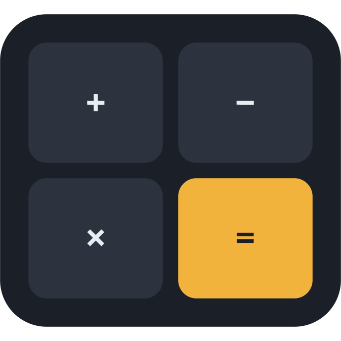

<p align="center">
  
</p>

# Count Me Out

A desktop calculator that really works, with a hidden, double-encrypted **Info Locker** behind it.
The name is a joke: to everyone else it's just a calculator, so count them out of your secrets.

Practice project for **functions, conditionals and edge cases** in Python.

## How it works

1. **First launch:** the calculator asks you to set an **8-digit PIN** on its keypad, then to type it again to confirm. Next, a dialog asks you to set a **password**, which is the second lock.
2. **Normal use:** it is an ordinary calculator, with `+ − × ÷`, `%`, `±`, decimals, `C`, `CE`, `⌫` and a history panel.
3. **The secret:** as soon as the number you are typing is exactly your PIN, the password prompt appears. You do not need to press `=`, and this works even in the middle of a calculation such as `5 + PIN`.
   - The **correct password** opens the Info Locker, where you store accounts, PINs and card numbers, IDs, contacts and notes.
   - A **wrong password or Cancel** quietly returns to the calculator showing `0`. Someone who typed your PIN by accident sees nothing unusual.
4. Press **Lock**, or close the locker window, to return to the calculator.

### Keyboard

The calculator can be used entirely from the keyboard, either the number row or the numpad. Each on-screen button lights up when you press its key.

| Key | Action |
| --- | --- |
| `0`–`9`, `.` or `,` | type a number |
| `+` `-` `*` (or `x`) `/` | operators |
| `Enter` or `=` | equals |
| `%` | percent |
| `F9` | ± (change sign) |
| `Backspace` | delete last digit |
| `Delete` | CE (clear entry) |
| `Esc` or `c` | C (clear all) |
| `Ctrl+C` / `Ctrl+V` | copy the result / paste a number |

The secret PIN can also be typed from the keyboard.

### Rules
- **PIN:** exactly 8 digits. It can't be all the same digit (`11111111`) or a straight sequence (`12345678`, `87654321`).
- **Password:** 6–32 characters, with at least one letter and one number, and no spaces at the start or end.

### Security
- The PIN and password are never stored. Only salted PBKDF2-SHA256 hashes are kept.
- The locker is encrypted **twice** with Fernet (AES + HMAC):
  - the inner layer uses a key derived from the **password**;
  - the outer layer uses a key derived from the **PIN**.
- Both are needed to read it.
- The PIN never appears in the calculation history.
- A copied secret is cleared from the clipboard after 30 seconds.

## Run it

```powershell
python -m venv .venv
.\.venv\Scripts\activate
pip install -r requirements.txt
python main.py
```

## Tests

```powershell
pytest
```

## Where data is stored

`%APPDATA%\SecretCalculator\` holds:
- `config.json`: the hashes and salts
- `locker.enc`: the encrypted locker
- `history.json`: calculation history

Data is kept outside the project folder so it can never be committed to git. You can set the `SECRET_CALCULATOR_HOME` environment variable to use a different folder.

**Forgot your PIN or password?** There is no recovery, which is the point. To start over, delete the `SecretCalculator` folder. This **permanently erases the locker**.

## Project layout

```
main.py                         entry point
secret_calculator/
  calculator.py                 arithmetic + key-press state machine (no eval)
  history.py                    calculation history
  security.py                   PIN/password rules, hashing, double encryption
  locker.py                     locker entries, search, encrypted save/load
  storage.py                    data folder and file helpers
  gui/calculator_window.py      calculator UI, first-run setup, secret trigger
  gui/password_dialog.py        masked password dialog
  gui/locker_window.py          Info Locker UI
tests/                          pytest unit tests
```
